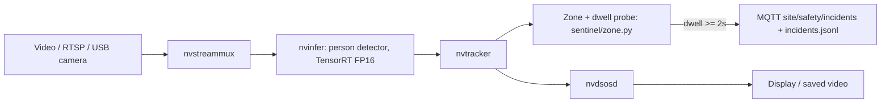

# PipeGen Workplace Safety Sentinel (Track A scaffold)

Hackathon: Embedded SF CraftifAI Physical AI Hackathon, https://luma.com/5z8w42mq

## Status (honest)
This repo is a **scaffold**. The PipeGen pipeline has **not** been built or run: the author's machine (Apple M4 Mac) has no NVIDIA GPU or Jetson. No TensorRT engine, speed report or live run exists. The consumer below is tested only against simulated events.

## Plan
Person detection + hazard-zone check on a site camera. PipeGen compiles the detector to TensorRT (FP16/INT8), runs it in DeepStream and publishes JSON incident events over MQTT. See `docs/PIPEGEN_REQUIREMENT.md` for the requirement text to paste into PipeGen's Requirement stage.

## Files
- `sentinel/zone.py` : polygon + dwell/cooldown logic (**5 unit tests pass**, `python3 -m unittest discover -s tests -t .`)
- `sentinel/publisher.py` : MQTT + JSONL incident publisher
- `sentinel/deepstream_app.py` : DeepStream/pyds pipeline with zone probe (**hand-written, untested on a GPU**)
- `configs/` : nvinfer, tracker, zone and label configs; `run.sh` launcher
- `docs/PIPEGEN_REQUIREMENT.md` : requirement prompt and expected output schema
- `consumer/alert_consumer.py` : MQTT subscriber that logs incidents to JSONL (`--simulate` generates fake events, clearly marked)


## What actually ran (real output, captured 16 Oct 2026)

**Zone logic unit tests (Apple M4 Mac, no GPU):**
```
----------------------------------------------------------------------
Ran 5 tests in 0.000s

OK
```

**Alert consumer in simulation mode** (events are fake and labelled `SIMULATED`; no camera, no model, no PipeGen):
```
[INCIDENT] 2026-10-16T22:53:39 track=1 zone=press-line dwell=3.3s source=SIMULATED
[INCIDENT] 2026-10-16T22:53:39 track=2 zone=press-line dwell=5.8s source=SIMULATED
[INCIDENT] 2026-10-16T22:53:40 track=3 zone=press-line dwell=2.7s source=SIMULATED
[INCIDENT] 2026-10-16T22:53:40 track=4 zone=press-line dwell=3.9s source=SIMULATED
[INCIDENT] 2026-10-16T22:53:41 track=5 zone=press-line dwell=4.9s source=SIMULATED
```

## Pipeline design (intended graph)
This is a hand-drawn design diagram. It is **not** a PipeGen Pipeline IR screenshot, and the pipeline has not been run through PipeGen.



## Not done
- No PipeGen run, no Pipeline IR screenshot, no TensorRT engine, no speed report, no demo video, no Export Project folder.
- `sentinel/deepstream_app.py` is untested on a GPU.

## Run the consumer (no GPU needed)
    python3 consumer/alert_consumer.py --simulate
